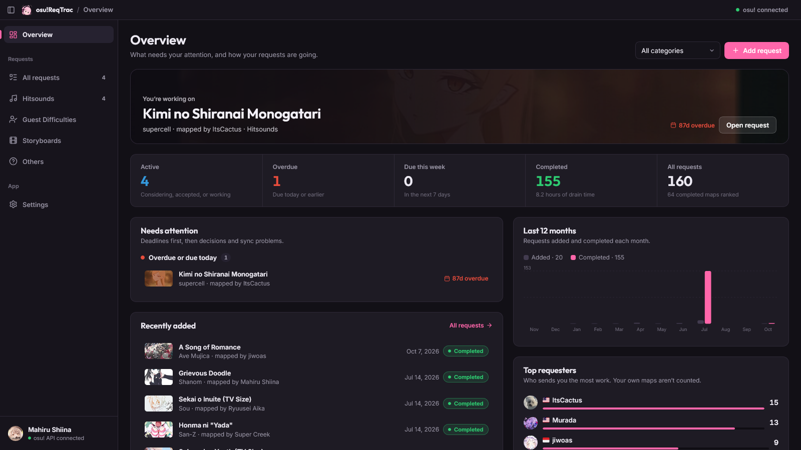
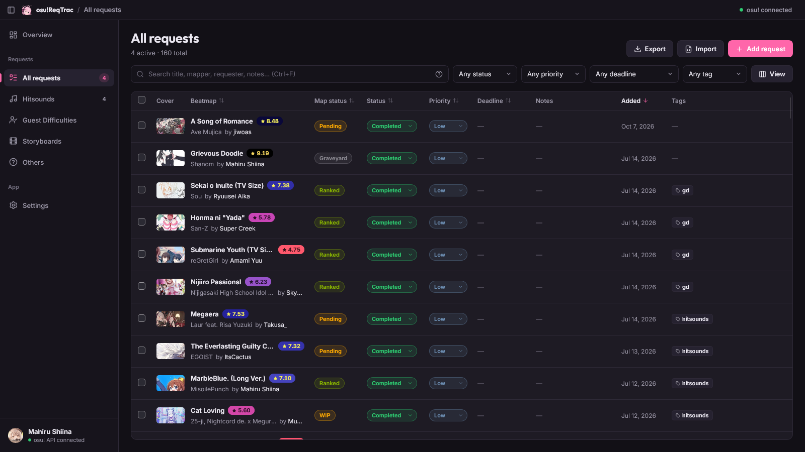
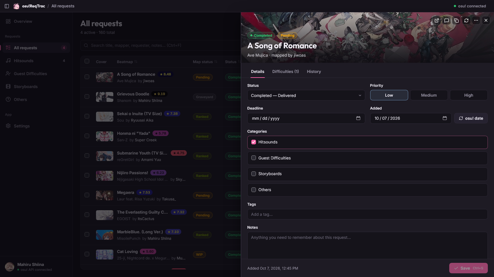

<h1 align="center">osu!ReqTrac</h1>

  

Keep track of your osu! hitsound, guest difficulty, and storyboard requests.

  <a href="https://github.com/SEApodEErman/osu-ReqTrac/releases/latest">Download</a> ·
  <a href="https://github.com/SEApodEErman/osu-ReqTrac/wiki">Wiki</a> ·
  <a href="https://github.com/SEApodEErman/osu-ReqTrac/issues">Report a bug</a>

## Features

- Paste a beatmap link to fill in its details, or add requests manually.
- Organize work with categories, statuses, priorities, and deadlines.
- Search, filter, and update requests in bulk.
- Import spreadsheets and Google Sheets, and publish a public request list.
- Keep your data locally, with backups and automatic app updates.

## Screenshots

  
  
  

## Get started

Download the latest release for **Windows, macOS, or Linux**, install it, and follow the setup in the app. Node.js is not needed to use a release build.

You can skip osu! API setup and track requests manually. Connect it later to fill in beatmap details automatically.

## Documentation

Setup and detailed guides live in the [Wiki](https://github.com/SEApodEErman/osu-ReqTrac/wiki):

- [Getting started](https://github.com/SEApodEErman/osu-ReqTrac/wiki/Getting-started)
- [Using ReqTrac](https://github.com/SEApodEErman/osu-ReqTrac/wiki/Using-ReqTrac)
- [Google Sheets](https://github.com/SEApodEErman/osu-ReqTrac/wiki/Google-Sheets)
- [Data and backups](https://github.com/SEApodEErman/osu-ReqTrac/wiki/Data-and-backups)
- [Development](https://github.com/SEApodEErman/osu-ReqTrac/wiki/Development) · [Releasing](https://github.com/SEApodEErman/osu-ReqTrac/wiki/Releasing)

## Help and contributions

Bug reports, suggestions, and pull requests are welcome on [GitHub](https://github.com/SEApodEErman/osu-ReqTrac/issues). You can also reach me through the [Discord server](https://discord.gg/Z5VFCdkExJ).

## License and credits

[MIT License](LICENSE). An independent community project, not affiliated with osu! or ppy Pty Ltd.

Vibe coded with [Google's Antigravity](https://antigravity.google/), [OpenAI's Codex](https://chatgpt.com/codex/), [Anthropic's Claude Code](https://claude.com/product/claude-code), and [OpenCode Zen](https://opencode.ai/zen). See [credits and notices](https://github.com/SEApodEErman/osu-ReqTrac/wiki/Credits-and-notices) for more.
